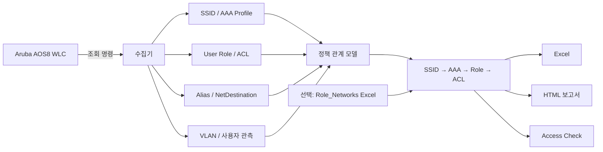
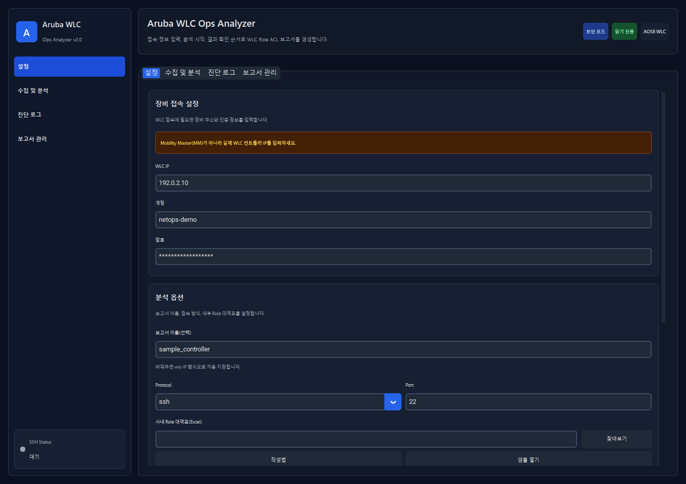
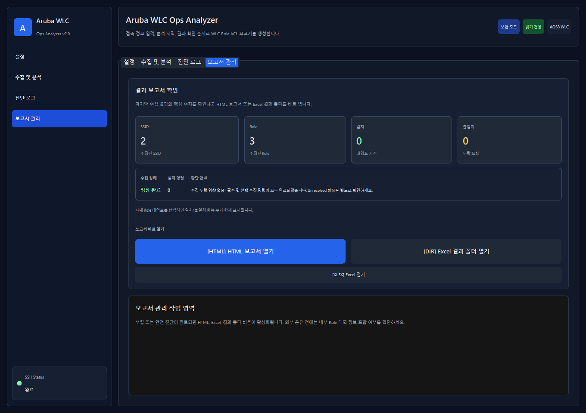

# Aruba AOS8 WLC Role / ACL 분석

**Aruba AOS8 WLC의 `SSID → AAA Profile → 기본 Role → ACL → Alias(NetDestination)` 관계를 자동 수집·구조화하고 Excel/HTML 보고서로 만드는 네트워크 운영 자동화 도구입니다.**

반복적인 CLI 조회와 수작업 정책 비교를 줄이고, **무선 서비스가 어떤 기본 Role과 ACL을 거쳐 어느 네트워크 범위에 접근할 수 있는지** 운영자가 빠르게 추적할 수 있도록 설계했습니다.

> 실제 운영 데이터는 저장소에 포함하지 않습니다. 문서와 화면 예시는 비식별 샘플·Mock 데이터만 사용합니다.

> **실제 환경 검증:** 기존 수집·분석 기능은 실제 사내 운영 환경에서 검증했습니다. 이번 오프라인 주석 작업·보고 기능의 회사 장비/Windows/인쇄 환경 수동 검증은 별도 사용자 범위입니다. 다만 사내 보안정책상 운영망 데이터(장비 출력, IP/Hostname, 계정, 원본 로그 및 기타 내부 데이터)는 외부 반출이 불가하여 공개 저장소에는 포함하지 않았습니다. 공개 Demo·fixture·문서 예시는 비식별 합성 데이터로 대체했으며, 공개 CI/자동 테스트 결과는 재현 가능한 공개 증거로 별도 제공합니다. 실제 환경 검증에 사용한 사내 원본 데이터 자체는 보안상 공개하지 않습니다.

## 포트폴리오 요약

| 채용 관점 | 내용 |
|---|---|
| 해결한 문제 | 여러 WLC CLI 화면을 따라가며 확인하던 SSID 접근 정책을 하나의 관계도와 보고서로 연결 |
| 담당 범위 | 문제 정의, SSH/Telnet 수집, Parser, ACL 평가, GUI·로컬 Web, Windows 패키징과 CI/CD |
| 핵심 판단 | 수집하지 못한 정책은 임의 추정하지 않고 `부분 완료/판정 불가`로 구분하며, 동적 CLI 인자는 전송 전에 차단 검증 |
| 보안 경계 | SSH 서버 키 고정, 변경 키 차단, Streamlit loopback 강제, Telnet 평문 위험과 비자동 전환 명시 |
| 검증 증거 | Mock/fixture, 대량 Role·ACL 회귀, Windows GUI·Web 통합 ZIP과 smoke 자동 검증 |
| 증거의 한계 | 자동·합성 검증이며 실제 운영 장비 성과나 현장 안전성을 입증하는 수치로 해석하지 않음 |

## 채용 검토자를 위한 읽는 순서

[포트폴리오 검토 안내](docs/PORTFOLIO_REVIEW_KO.md)에서 **설계 질문 → 실제 코드 → 실패 사례 테스트 → 장비 없는 재현 → 검증 한계** 순서로 확인할 수 있습니다. 아래 운영 설명과 함께 읽으면 기능 주장과 공개 근거를 대조할 수 있습니다.

## 한눈에 보기

### 공개 Mock WLC 데모와 소스

[브라우저에서 공개 데모 체험](https://sebia1993-wireless-policy-demo.streamlit.app/) · [데모 소스](portfolio_demo/app.py)

공개 데모는 `portfolio_demo/app.py`에서 실행합니다. 접속 대상은 서버가 시작한 loopback Mock WLC로 고정되어 있고 자격 증명은 합성 데이터만 사용합니다. 정상 수집, 부분 수집 실패, 인증 실패, 설정 수집 실패를 선택해 수집 기록과 결과를 확인할 수 있습니다. 로컬 운영 앱(`app.py`)과 같은 Parser·분석·보고서 생성 코드를 사용합니다.

### 로컬 운영 앱

| 항목 | 내용 |
|---|---|
| 대상 | Aruba AOS8 WLC |
| 분석 흐름 | SSID → AAA Profile → 기본 Role → ACL → Alias / NetDestination |
| 기본 Role | `initial-role`, `mac-default-role`, `dot1x-default-role` |
| 접속 | SSH 또는 Telnet 직접 선택, 자동 전환 없음 |
| 장비 변경 | **없음 — 조회 중심 수집, 설정 변경 명령 사용 안 함** |
| 결과 | Excel, HTML, 생성 상태 JSON |
| 추가 분석 | Role별 ACL 상세, Access Check, Role 대역 비교, VLAN/사용자 관측 정보 |
| 실행 방식 | Windows GUI / 로컬 Streamlit 웹앱 |
| 오프라인 운영 | Windows 통합 ZIP 제공, Python 별도 설치 불필요 |
| 검증 | Mock/fixture, 대량 데이터 회귀, Windows 패키지/통합 ZIP CI 검증 |

## 해결하려 한 운영 문제

Aruba 무선 환경에서 특정 SSID의 실제 접근 정책을 확인하려면 여러 Profile과 Role, ACL을 연속해서 따라가야 합니다.

- SSID와 AAA Profile의 연결 관계를 일일이 확인해야 함
- `initial-role`, `mac-default-role`, `dot1x-default-role`이 서로 달라 정책 해석이 복잡함
- User Role에서 ACL 이름만 확인해도 실제 목적지 범위는 Alias/NetDestination을 다시 조회해야 함
- ClearPass/RADIUS가 동적 Role을 반환하는 환경에서는 WLC의 기본 Role만 보고 실제 적용 Role을 단정하면 안 됨
- 일부 명령 수집이 실패했을 때 나머지 정상 결과까지 사용할 수 없는 것처럼 보이거나, 반대로 불완전한 결과를 정상으로 오판할 수 있음
- CLI 출력과 Excel을 수작업으로 비교하면 누락·복사 오류가 발생하기 쉬움

이 프로젝트는 단순 명령 수집보다 **정책 관계를 연결하고, 수집 신뢰도와 분석 한계를 함께 표시하는 것**을 목표로 합니다.

## 핵심 설계 판단

| 운영 문제 | 설계 판단 |
|---|---|
| SSID 정책 경로가 여러 객체로 분산 | SSID → AAA → Role → ACL 관계를 하나의 모델로 연결 |
| 기본 Role 종류가 여러 개 | `initial/mac-default/dot1x-default`를 구분해 보고서에 각각 표시 |
| ACL의 Alias만으로 실제 범위를 알 수 없음 | Alias를 NetDestination 정의까지 추적해 네트워크 범위와 함께 정리 |
| 동적 Role을 기본 Role로 오인할 위험 | ClearPass/RADIUS 동적 Role은 **가능성**으로 분리하고 직접 수집한 값처럼 표시하지 않음 |
| 일부 명령 실패 시 결과 신뢰도 판단 필요 | `정상 완료 / 부분 완료 / 수집 실패` 상태와 영향 Role/SSID를 함께 계산 |
| 불완전한 Alias/ACL에서 잘못된 접근 허용 판정 위험 | 선행 정보가 부족하면 Access Check를 억지로 통과시키지 않고 `판정 불가`로 중단 |
| 동일 작업을 반복할 때 사람이 Excel을 다시 정리 | Excel/HTML을 동일 수집 모델에서 자동 생성 |
| 내부 Role 대역표와 WLC 추정값 비교 필요 | 선택적으로 `Role_Networks` Excel을 읽어 로컬 기준과 수집값 비교 |
| 현장 장애 재현 시 운영 정보 공유가 어려움 | IP·계정·원문을 제거한 안전 진단 보고서와 안정 오류 코드 사용 |

## 분석 구조



핵심 분석 경로는 다음과 같습니다.

```text
SSID
 ↓
AAA Profile
 ↓
initial / mac-default / dot1x-default Role
 ↓
Role에 연결된 ACL
 ↓
ACL Rule
 ↓
Alias가 있으면 NetDestination 실제 범위
 ↓
Excel / HTML / Access Check
```

## 분석 경계

정확한 결과를 위해 **수집한 사실과 추정 가능한 범위를 구분**합니다.

- ClearPass/RADIUS 서버에서 동적 Role을 직접 조회하지 않습니다.
- RADIUS 연계가 확인되는 경우 `동적 Role 가능성`으로 표시합니다.
- service object를 TCP/UDP 포트 번호까지 완전 해석하는 기능은 현재 범위가 아닙니다.
- 수집 실패가 있으면 영향을 받는 Role/SSID와 신뢰도를 결과에 표시합니다.
- Access Check는 필요한 선행 정보가 부족하면 허용/차단을 임의 추정하지 않습니다.

## 실행 및 결과 화면

[화면별 사용 흐름](docs/USAGE_SCREENSHOTS_KO.md)에서 현재 앱의 설정 → 분석 단계 → 보고서 해석 → 로그를 확인할 수 있습니다. 아래는 Windows의 실제 CustomTkinter 창이며 합성 입력과 오프라인 fixture 계산 결과를 사용했습니다. 실제 SSH 연결은 하지 않았습니다.





SSID → Role → ACL 상세와 Access Check의 이전 HTML 예시는 [2026-06-30 legacy 갤러리](design_screenshots/README.md)에 보존했습니다. 이전 흰색 GUI와 실행 전 Access Check 화면을 현재 앱이나 검증된 정책 판정의 증거로 해석하지 마십시오.

## 주요 결과물

수집이 끝나면 날짜시간과 충돌 방지 구분값을 사용하는 실행 디렉터리에 결과를 생성합니다. CSV는 장비 목록 입력 형식이며 자동 보고서 출력은 Excel과 HTML입니다.

```text
<출력 루트>/<실행 디렉터리>/
├── ssid_role_acl_report.xlsx
├── ssid_role_acl_report.html
├── report_status.json
└── raw/
```

### Excel

- SSID와 AAA Profile 관계
- 기본 Role 종류별 매핑
- Role과 ACL 관계
- Alias / NetDestination 범위
- 선택적 Role 대역 비교
- 수집 상태와 영향 범위

### HTML

- 관리자 요약
- SSID / Role 관계
- Role별 ACL 상세
- **B안 원본·주석 통합 테이블:** 선택한 Role 안에서 `통합 정책·주석` / `ACL 접근 판정` 두 탭을 사용합니다. Source/Destination/Service/Action과 주석을 같은 ACL 행에 보여주고, 원문·관련 Alias·수집 근거는 각 규칙에서 필요할 때만 펼칩니다. 중복된 `수집 상세` 탭은 제거합니다
- Role 옆 `SSID 명` 직접 입력 및 `단말 구분`(윈도우 PC / 맥북 / mobile / ETC, 기존 파일의 PC 분류 유지) 선택. 수집된 SSID와 분리하여 JSON·주석 HTML·이전 주석 재사용·Excel/PDF 보고 내용에 보관. 과거 작업 파일은 새 버전에서도 열리지만, 새 기기 분류를 저장한 작업 파일은 이를 지원하지 않는 구버전에서 열리지 않을 수 있습니다
- JSON 작업 저장·열기, 이전 주석 재사용과 미연결 설명 보존
- 전체/선택 Role/변경·확인 범위의 실제 XLSX 및 **인쇄 창 없는 오프라인 한글 텍스트 PDF 직접 다운로드**. 간단 보고서는 규칙과 행별 주석을 보여주며, 상세 보고서는 핵심 요약→Role 현황→확인 필요→전용·공통 ACL·Alias 부록 순서로 구성
- 현재 작업을 담은 독립 HTML 편집기 저장
- `통합 정책·주석`의 수집 신뢰도·원본 근거 요약, 고급 접힘 영역에서 원본 전체 보고서·선택 Role PNG 저장(원본 수집본이 일치할 때만 사용 가능)
- `global-sacl`, `ra-guard`, `re-guard`, `logon-control` 공통 ACL은 Role의 주석 화면에서 기본 숨김, `공통 ACL 함께 보기`로 복원. 정확한 ACL 이름만 분류하며 원본·저장·보고 데이터는 변하지 않습니다.
- Access Check
- 부분 수집 시 영향 Role/SSID와 권장 조치

작업을 이어 갈 기준은 수집본·설명·확인 이력을 함께 보관하는 JSON 파일입니다. `작업 열기`는 작업 전체를 바꾸고, `이전 주석 가져오기`는 현재 수집본에 설명을 대조합니다. 다운로드는 디스크의 기존 파일을 자동 덮어쓰지 않으며 Excel/PDF는 보고용입니다. 자세한 절차는 [주석 작업·저장·보고 범위](docs/USER_GUIDE_KO.md#8-작업-저장재사용보고서-내보내기)를 참고하십시오. 이번 주석 기능의 실제 회사 장비·Windows·PDF 뷰어 환경 수동 검증은 별도 사용자 범위입니다.

## 안전 및 운영 원칙

- 장비 계정과 비밀번호를 코드에 저장하지 않습니다.
- SSH는 자격 증명을 장비로 전송하기 전에 SHA-256 서버 키 지문을 검토하고 앱 전용 `known_hosts`에 고정합니다.
- 승인되지 않은 SSH 키와 변경된 키는 차단하며, SSH 실패를 Telnet으로 자동 전환하지 않습니다.
- Telnet은 계정과 장비 출력이 암호화되지 않으므로 격리된 관리망에서 위험을 승인한 경우에만 직접 선택합니다.
- Streamlit은 `127.0.0.1` 등 loopback 주소에서만 실행되고 외부 인터페이스 바인딩은 차단됩니다.
- GUI/Web에서 실제 WLC 수집과 테스트 fixture를 분리합니다.
- Raw 장비 출력과 내부 Role 대역표는 공개 저장소에 포함하지 않습니다.
- 안전 진단 결과는 주소·계정·Role/ACL 원문 등 운영 정보를 마스킹합니다.
- GUI 작업 취소와 종료 시 장비 세션을 정리하도록 설계했습니다.
- 전체 live 수집에는 60분 상한을 두고 명령 Timeout은 5~600초 범위로 제한합니다.

상세 보안 경계는 [보안 모델](docs/SECURITY_MODEL_KO.md), 현장 진단은 [진단 모드 안내](docs/DIAGNOSTIC_MODE_KO.md)를 참고하십시오.

## 검증

자동 검증과 실제 운영 검증은 같은 의미로 취급하지 않습니다.

| 검증 항목 | 상태 |
|---|---|
| Parser / ACL 평가 단위 테스트 | ✅ 자동 검증 |
| Mock WLC / fixture 기반 수집 | ✅ 자동 검증 |
| GUI / Web 공통 상태 모델 | ✅ 자동 검증 |
| 60 Role / 1,200 ACL 회귀 | ✅ 자동 검증 |
| 100 Role / 4,000 ACL HTML 렌더링 경로 | ✅ 검증 항목 포함 |
| Windows GUI 패키지 | ✅ GitHub Actions |
| Streamlit portable 패키지 | ✅ GitHub Actions |
| GUI + Web 통합 ZIP | ✅ GitHub Actions |
| 실제 운영 환경 결과 | 공개 자료에서는 민감정보를 제거한 검증 요약만 관리 |

구체적인 검증 항목과 공개 가능한 증거 범위는 [검증 보고서](docs/VALIDATION_REPORT.md)에 정리합니다.

## 빠른 시작

일반 사용자는 GitHub **Releases**의 Windows 통합 ZIP을 사용합니다.

```text
wlc-role-acl-collector_v0.5.1_windows.zip
```

압축을 완전히 푼 뒤 목적에 맞는 실행 경로를 선택합니다.

### 통합 ZIP 구성

```text
README_START_HERE_KO.txt
gui/
  WlcRoleAclCollectorGUI.exe
web/
  start_webapp.cmd
  webapp_settings.cmd
```

GitHub의 `Source code (zip)` / `Source code (tar.gz)`는 소스 아카이브이며 일반 사용자용 실행 파일이 아닙니다. Mock 검증 데이터는 배포본의 `config/mock_scenarios` 아래에 포함됩니다.

### Windows GUI

```text
gui\WlcRoleAclCollectorGUI.exe
```

권장 흐름:

1. WLC 주소와 SSH/Telnet 접속 정보를 입력합니다.
2. 필요한 경우 Enable password와 Role 대역표 Excel을 지정합니다.
3. `분석 시작`을 실행합니다. SSH는 서버 키를 인증 전에 자동 조회하며, 처음 보는 키라면 SHA-256 지문 확인창이 나타납니다. 반드시 별도 관리 경로의 지문과 대조한 뒤 승인하세요. 이미 승인된 키는 창 없이 진행하며, 변경된 키는 자동 승인 없이 차단됩니다.
4. `정상 완료 / 부분 완료 / 수집 실패` 상태를 확인합니다.
5. HTML/Excel 결과에서 SSID → Role → ACL 관계를 확인합니다.

로컬 웹앱은 신규 SSH 장비 접속 시 SHA-256 지문 승인창을 표시합니다. 별도 확인 후 체크박스를 선택하고 승인해야 수집이 시작됩니다.

### 로컬 웹앱

```text
web\start_webapp.cmd
```

기본 접속 주소:

```text
http://127.0.0.1:8763
```

웹앱은 실행한 PC의 loopback 주소에서만 동작합니다. 최초 SSH 접속 시 지문을 보여 주는 승인창이 열리며, 이미 승인한 키는 창 없이 확인합니다. 저장된 키와 달라진 경우에는 연결을 차단하고 자동으로 갱신하지 않습니다. 서버 또는 원격 공용 서비스로 배포하지 마십시오.

더 자세한 실행 절차는 [사용자 가이드](docs/USER_GUIDE_KO.md)를 참고하십시오.

## 개발 및 검증

Python 3.11 이상과 Node.js 20 이상에서:

```powershell
python -m pip install --require-hashes -r requirements-lock.txt
python -m pip install --no-deps --no-build-isolation -e .
npm ci --ignore-scripts
python -m pytest
npm test
powershell -NoProfile -ExecutionPolicy Bypass -File .\tools\validate.ps1
```

Windows 통합 패키지는 GitHub Actions 또는 Windows 환경에서 검증합니다.

개발 구조와 변경 원칙은 [`DEVELOPMENT.md`](DEVELOPMENT.md), 세부 모듈 설명은 [개발자 가이드](docs/DEVELOPER_GUIDE_KO.md)를 참고하십시오.

## 문서

| 문서 | 용도 |
|---|---|
| [사용자 가이드](docs/USER_GUIDE_KO.md) | 설치·실행·결과 확인 |
| [개발자 가이드](docs/DEVELOPER_GUIDE_KO.md) | 모듈 구조와 개발 흐름 |
| [검증 보고서](docs/VALIDATION_REPORT.md) | 자동/운영 검증 경계와 체크리스트 |
| [보안 모델](docs/SECURITY_MODEL_KO.md) | 민감정보·접근·진단 경계 |
| [의존성 감사 예외](docs/DEPENDENCY_AUDIT_EXCEPTIONS_KO.md) | 고정 취약점 예외·보완 통제·제거 기한 |
| [오류 코드](docs/ERROR_CODES_KO.md) | 오류 의미와 1차 조치 |
| [진단 모드](docs/DIAGNOSTIC_MODE_KO.md) | 비식별 현장 진단 |
| [Release 운영](RELEASE_NOTES.md) | 배포 기준과 산출물 계약 |
| [변경 이력](CHANGELOG.md) | 기능 변경 기록 |

## 현재 제외 범위

- ClearPass/RADIUS 서버에서 동적 Role 직접 조회
- service object의 모든 TCP/UDP 포트 정밀 해석
- Streamlit 자체 사용자 로그인/권한 관리
- 코드서명 / installer / MSIX
- macOS에서 Windows EXE를 직접 생성하는 공식 빌드 경로

이 저장소의 목적은 **Aruba 정책 객체를 많이 수집하는 것 자체가 아니라, 무선 서비스와 접근 제어 정책의 관계를 운영자가 추적 가능한 형태로 만드는 것**입니다.

## 함께 보는 네트워크 자동화 프로젝트

| 프로젝트 | 보여주는 역량 |
|---|---|
| [Aruba Cluster Health Dashboard](https://github.com/sebia1993/aruba-cluster-health-dashboard) | 무선 클러스터 관측값의 상관분석과 오탐 억제 |
| [Aruba MM Session Cleanup](https://github.com/sebia1993/aruba-mm-session-cleanup) | 상태 변경 자동화의 승인·대상 고정·사후 검증 |
| [Aruba 2930F Config Backup](https://github.com/sebia1993/aruba-2930f-config-backup) | 읽기 전용 설정 수집과 SSH 지문·결과 무결성 통제 |

## 라이선스와 보안 제보

프로젝트 코드는 [MIT License](LICENSE)로 배포합니다. 민감한 취약점은 공개 Issue 대신 GitHub Security의 비공개 취약점 제보 기능을 사용하십시오.
